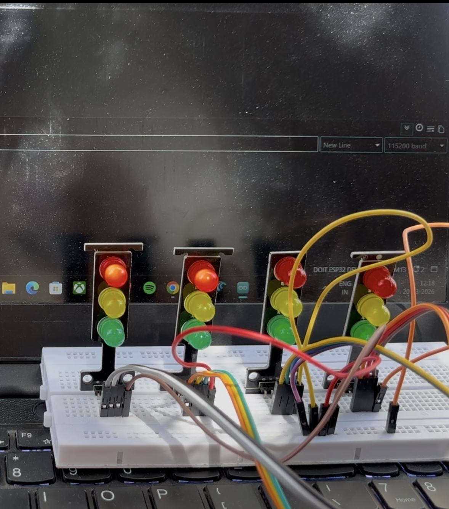
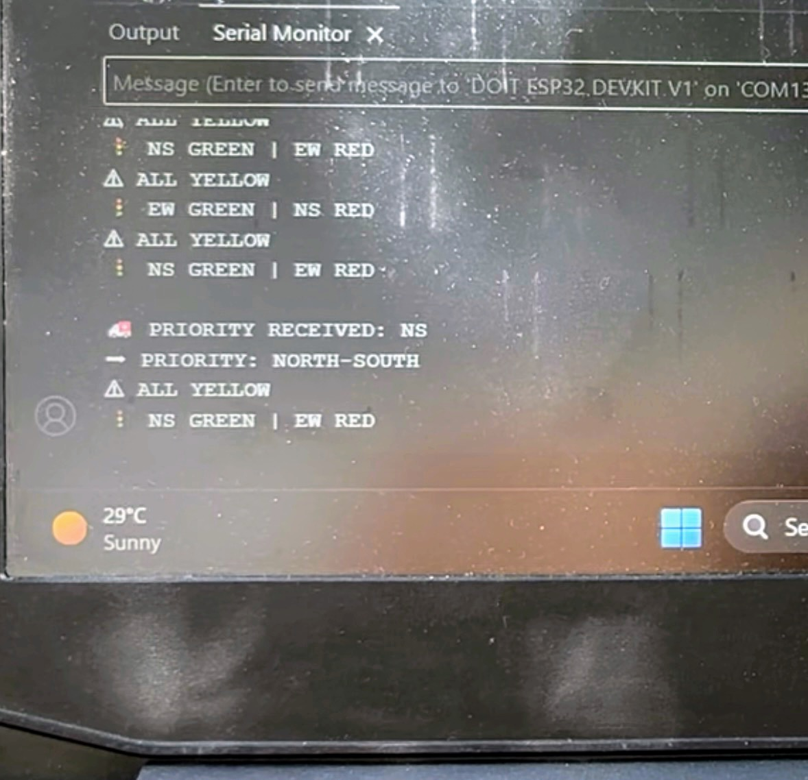

# Project demonstration

## Hardware

I wired four red/yellow/green traffic-signal modules to the ESP32. This photo shows the assembled breadboard and signal-module connections.

## MQTT priority log

The log shows normal NS/EW cycling, receipt of an `NS` priority command, an all-yellow transition, and North–South green with East–West red.

## Videos

| Recording | Link | Duration | Coverage |
|---|---|---:|---|
| Demo 1 | [Watch MP4](media/demo-01.mp4) | About 38 s | Breadboard, four signal modules, ESP32 board and Serial Monitor |
| Demo 2 | [Watch MP4](media/demo-02.mp4) | About 93 s | Signal operation alongside the controller's Serial Monitor |

These are full-duration MP4 copies of my original project recordings, converted for browser compatibility and smaller upload size. Audio is retained. Click a link to open or download the video; playback depends on the viewer.

## Integrated test

We tested the complete sequence using live phone GPS and server-generated commands:

1. The phone provided live location updates.
2. The server processed the location and generated a priority command.
3. MQTT delivered the command to the ESP32.
4. My controller applied the priority phase to the traffic-signal modules.

The integrated sequence worked, with a slight delay due to the network connection. I did not record a numerical end-to-end latency measurement. The recordings focus on the physical controller and Serial Monitor; they do not show every upstream tracking step on screen.

The local `mosquitto_pub` commands in [MQTT_PROTOCOL.md](MQTT_PROTOCOL.md) are an additional way to test the controller independently. They are not a description of how the live GPS demonstration generated its commands.
