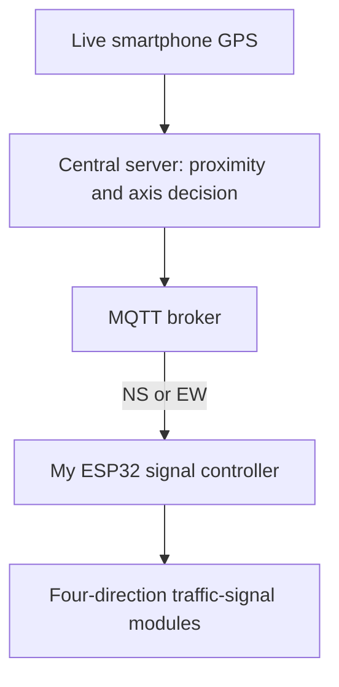
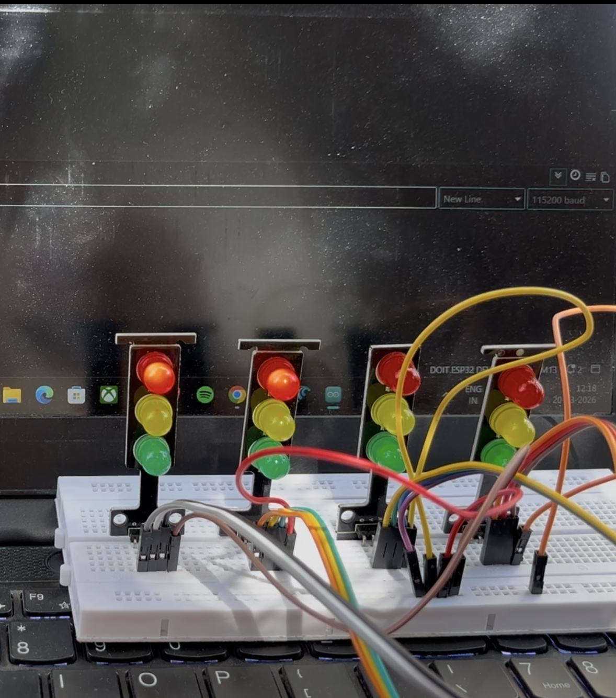
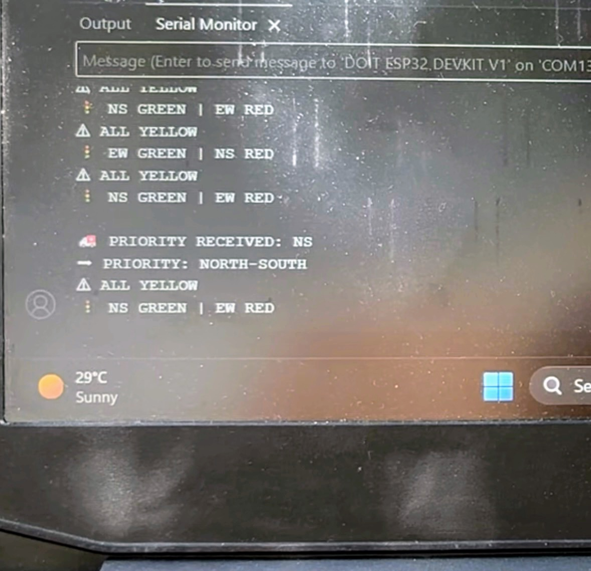

# IoT-Based Automated Green Corridor for Emergency Vehicles

### ESP32 traffic-signal control using Wi-Fi and MQTT

I worked on this project to give emergency vehicles priority at traffic intersections. My contribution covered **ESP32 programming, wiring the traffic-signal modules, and MQTT integration**.

This repository contains my traffic-signal controller firmware, its pin connections, and instructions for running it. It is part of our wider academic project, which used live smartphone GPS and a central server to track the emergency vehicle and decide which signal axis needed priority.

**Technologies:** ESP32 · Arduino C++ · Wi-Fi · MQTT · PubSubClient · GPIO

## My contribution

- **ESP32 programming:** I programmed the normal signal cycle, MQTT command handling, and temporary emergency-priority override.
- **Wiring:** I connected four-direction traffic-signal modules to the ESP32 using twelve GPIO outputs.
- **MQTT integration:** I integrated the ESP32 with the MQTT broker so it could receive North–South (`NS`) and East–West (`EW`) priority commands from the central server.

The smartphone tracking application and server-side routing and proximity logic were part of the wider team project. This repository focuses on the controller I worked on.

## How the system works



The server sends a priority command through MQTT. My ESP32 controller receives it, switches to the priority sequence, and returns to its normal cycle after the priority timer expires.

The controller receives the required axis from the server; it does not calculate routes or read GPS itself. The application and server source are outside this repository.

## Signal operation

| Mode | Sequence |
|---|---|
| Startup | All directions red for 3 seconds, followed by connection setup |
| Normal cycle | NS green for 10 seconds → all yellow for 2 seconds → EW green for 10 seconds → all yellow for 2 seconds |
| NS priority | All yellow for 1 second → NS green / EW red for 10 seconds → normal cycle resumes |
| EW priority | All yellow for 1 second → EW green / NS red for 10 seconds → normal cycle resumes |

North and South share a green phase, as do East and West. In this version, priority ends on a **fixed timer**, rather than a vehicle-passage event.

## Project photos and videos



*Four traffic-signal modules connected on a breadboard for the ESP32 controller demonstration.*

**[Watch demo 1 — hardware and controller (38 seconds)](docs/media/demo-01.mp4)**  
**[Watch demo 2 — signal operation and Serial Monitor (93 seconds)](docs/media/demo-02.mp4)**



*Serial Monitor showing `PRIORITY RECEIVED: NS`, followed by the yellow transition and North–South green state.*

The videos show the physical controller and its output. During the integrated test, we used **live phone GPS and server-generated MQTT commands**. I observed a slight delay due to the network connection; I did not record a measured latency value. See [demonstration details](docs/DEMO.md).

## Hardware connections

| Direction | Red GPIO | Yellow GPIO | Green GPIO |
|---|---:|---:|---:|
| North | 5 | 18 | 19 |
| South | 21 | 22 | 23 |
| East | 13 | 12 | 14 |
| West | 25 | 32 | 33 |

I used traffic-signal modules with active-high control. See [hardware notes](docs/HARDWARE.md) for wiring considerations.

## Run the controller

1. Install the ESP32 board package and PubSubClient library in Arduino IDE.
2. Copy `firmware/green_corridor/config.example.h` to `config.h` in the same folder.
3. Enter your Wi-Fi and MQTT settings in `config.h`.
4. Open `firmware/green_corridor/green_corridor.ino`, select your ESP32 board and serial port, then verify and upload.
5. Open Serial Monitor at **115200 baud**.
6. Publish `NS` or `EW` to your configured MQTT topic.

See [setup instructions](docs/SETUP.md) and [MQTT demo commands](docs/MQTT_PROTOCOL.md) for the full steps. Wi-Fi credentials stay in the local `config.h`, which is excluded from Git.

## Repository contents

| Location | Contents |
|---|---|
| `firmware/green_corridor/` | ESP32 sketch and example configuration |
| `docs/HARDWARE.md` | Pin map and wiring notes |
| `docs/SETUP.md` | Installation, upload and troubleshooting |
| `docs/MQTT_PROTOCOL.md` | Commands and controller behavior |
| `docs/CONTRIBUTION.md` | My responsibilities and wider project scope |
| `docs/DEMO.md` | Project photos, videos and demonstration notes |
| `docs/SYSTEM_OVERVIEW.md` | Wider system architecture and controller interface |
| `docs/VALIDATION.md` | Test coverage and hardware test log |
| `docs/LIMITATIONS.md` | Current limitations and improvements |
| `tests/` | Host tests with mocked hardware and network interfaces |

## Testing and improvements

The included host tests pass for phase timing, priority commands and return to normal operation. They also capture the current behavior for repeated and invalid messages. Run them with:

```sh
python3 tests/run_tests.py
```

These tests use Python 3 and `g++`; they do not replace an ESP32 build or hardware test. We also tested the live phone GPS → server → MQTT → ESP32 → signal-module sequence successfully. The network introduced a slight observable delay. The project recordings and test notes are documented in [VALIDATION.md](docs/VALIDATION.md).

The current prototype uses blocking MQTT reconnection and simplified signal transitions. My next improvements would be command validation, nonblocking reconnection and explicit clearance states. See [limitations](docs/LIMITATIONS.md) for details. This is an academic prototype for bench demonstration.

## About me

**Eshan Walsangikar**  
B.Tech, Electronics & Telecommunication Engineering  
Bharati Vidyapeeth College of Engineering, Pune  
[LinkedIn](https://www.linkedin.com/in/eshan-walsangikar-4951a8257/)

## References

- [Arduino-ESP32 installation](https://docs.espressif.com/projects/arduino-esp32/en/latest/installing.html)
- [PubSubClient API](https://pubsubclient.knolleary.net/api)
